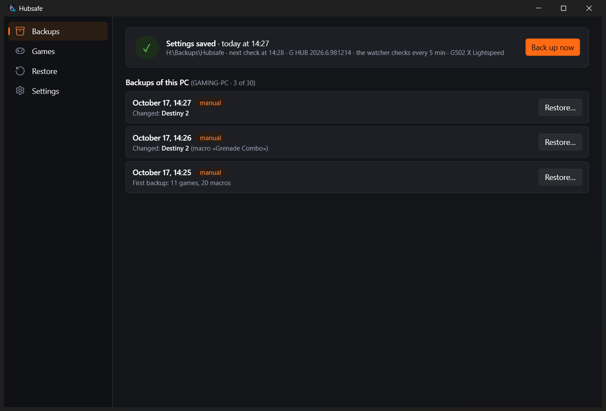
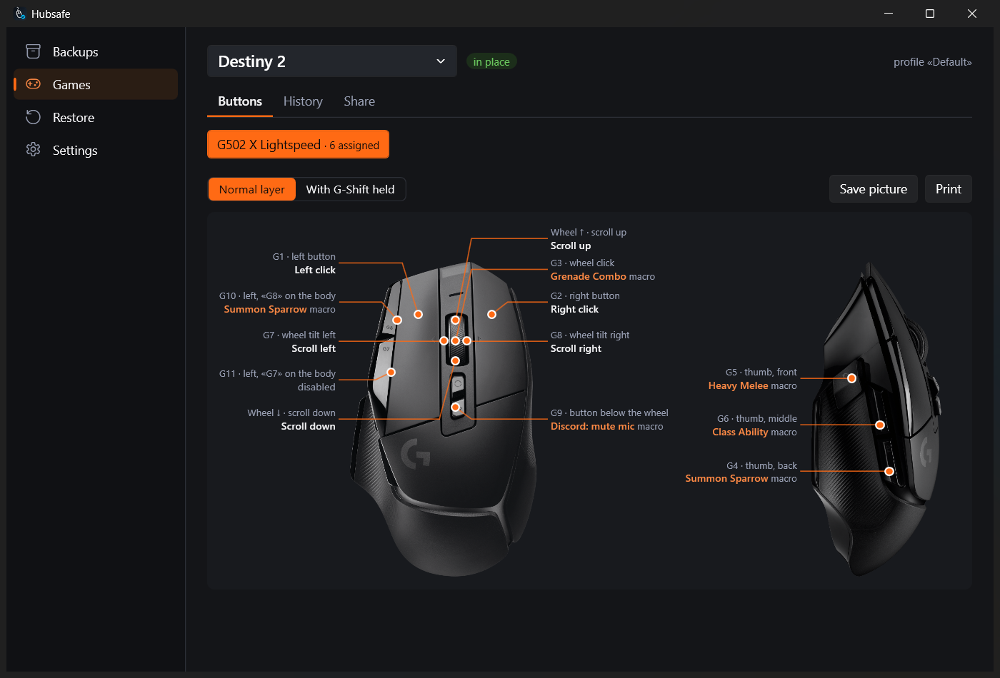
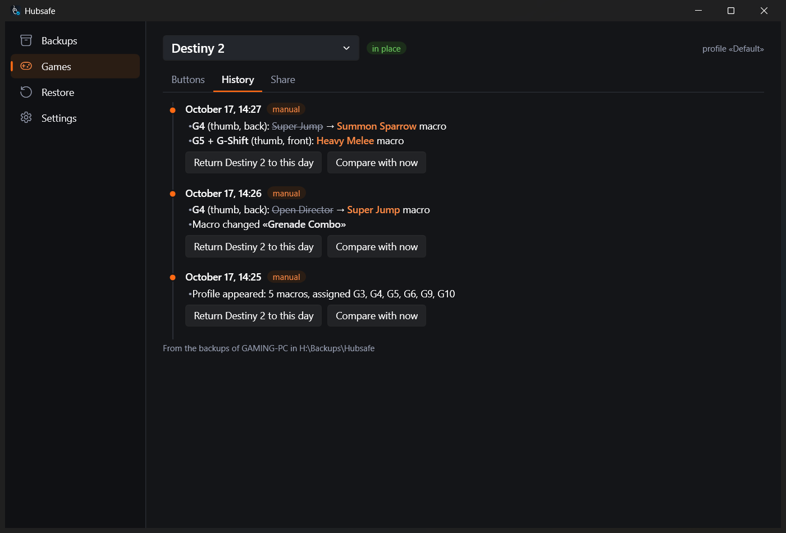
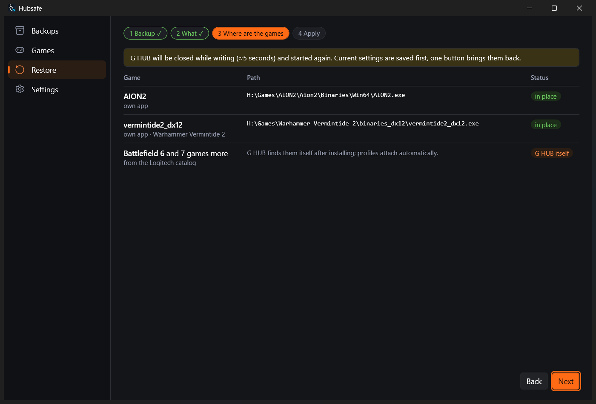
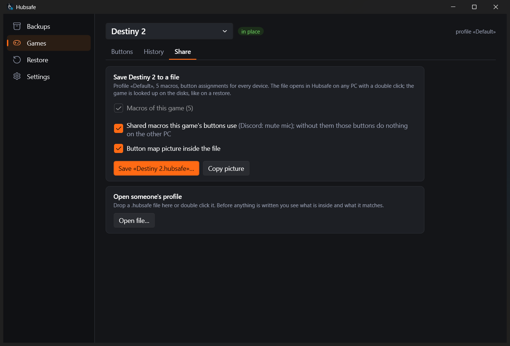

# Hubsafe

**Backups of Logitech G HUB settings for Windows 10/11.** G HUB keeps profiles, macros and button
assignments only on your PC: reinstall Windows or G HUB, or let an update go wrong, and they are gone.
Hubsafe saves them to a NAS or any folder whenever something changes, and puts them back, all at once
or game by game, even when your games now live on another drive.

**[⬇ Download the latest version](https://github.com/zemidala/hubsafe-releases/releases/latest)**: take `Hubsafe-<version>-win-x64.zip`, unzip and run `Hubsafe.exe`. No installation and no .NET required.

English and Russian interface · Русский интерфейс — [see below](#русский)

## Features

- **Backups when something changes.** Hubsafe checks G HUB every hour (you choose) and saves a copy only if your settings changed. Each backup says what changed: “Destiny 2 (macro «Grenade Combo»)”, “Desktop (DPI 1200 → 1400)”. Several PCs can share one folder; each gets its own subfolder.
- **Restore after a reinstall.** Install G HUB, start Hubsafe, pick a backup. Restore everything or only some games; the rest of G HUB stays as it is. Games that moved to another drive or Steam library are found again, and you can point to an exe by hand. G HUB is closed for a few seconds while writing, and the state before the restore is saved, so one button undoes it.
- **Button map.** The photo of your mouse from G HUB itself, with every button labelled: what G5 does in Destiny 2, which macro sits on the wheel click, what changes with G-Shift held. Save it as a picture or print it. Devices G HUB has no photo of are shown as a list.
- **Game history.** What changed in a game and when, with the old value crossed out. Return one game to any day; other games are not touched.
- **Share a game.** Save a game's profile and macros to a `.hubsafe` file, with an optional button map picture inside. A double click opens it in Hubsafe on another PC: it shows what is inside and finds the game on the disks before writing anything.
- **Watcher.** G HUB sometimes loses settings after sleep or an update. Every 5 minutes Hubsafe compares G HUB with the last backup (read only) and, if profiles or macros disappeared, a notification offers to put them back.
- Dark and light themes, tray icon, start with Windows, update check.

| Button map | Game history |
|---|---|
|  |  |

| Restore: where are the games | Share a game |
|---|---|
|  |  |

## Install

1. Download `Hubsafe-<version>-win-x64.zip` from [Releases](https://github.com/zemidala/hubsafe-releases/releases/latest) and unzip it to any folder.
2. Run `Hubsafe.exe`. The app is not code-signed yet, so Windows SmartScreen may warn you: click **More info → Run anyway**.
3. On the first start, choose where to keep backups (a NAS share or any folder) and press **Check access**.
4. To update, exit Hubsafe from the tray and replace `Hubsafe.exe` with the new one (the bare exe is attached to every release too). Settings and backups stay.
5. Settings are in `%APPDATA%\Hubsafe`, undo copies in `%LOCALAPPDATA%\Hubsafe`. To uninstall, delete the exe and those two folders; your backups stay where you put them.

Hubsafe reads G HUB's settings from `%LOCALAPPDATA%\LGHUB` and writes them only when you restore. Nothing is sent anywhere except the update check on GitHub.

The *Source code (zip / tar.gz)* links on a release are added by GitHub automatically. Hubsafe is closed source, so they contain only this README, not the program.

## Feedback

- 🐞 Found a bug or want a feature? [Open an issue](https://github.com/zemidala/hubsafe-releases/issues/new/choose).
- 💬 Questions, ideas, your setups — [Discussions](https://github.com/zemidala/hubsafe-releases/discussions).

English or Russian — both are fine.

Hubsafe is not made by or affiliated with Logitech. Logitech, Logitech G and G HUB are trademarks of Logitech.

---

## Русский

**Копии настроек Logitech G HUB для Windows 10/11.** G HUB хранит профили, макросы и назначения кнопок
только на вашем ПК: переустановили Windows или G HUB, неудачно обновились — и их нет. Hubsafe сохраняет
их на NAS или в любую папку, как только что-то меняется, и возвращает обратно целиком или по играм,
даже если игры теперь стоят на другом диске.

**[⬇ Скачать последнюю версию](https://github.com/zemidala/hubsafe-releases/releases/latest)**: возьмите `Hubsafe-<версия>-win-x64.zip`, распакуйте и запустите `Hubsafe.exe`. Без установки, .NET не нужен.
Русский язык: **Settings → Language → Русский**, переключается сразу.

Возможности:

- копии по изменениям: проверка раз в час (можно чаще или реже), у каждой копии написано, что поменялось; несколько ПК могут писать в одну папку;
- восстановление после переустановки целиком или по играм, остальное в G HUB не трогается; игры, переехавшие на другой диск или в другую библиотеку Steam, находятся сами; перед записью текущее состояние сохраняется, отменить можно одной кнопкой;
- карта кнопок на фото вашей мыши из самого G HUB: что делает каждая кнопка в игре, включая слой G-Shift; можно сохранить картинкой или распечатать;
- история игры: что и когда менялось, старое значение зачёркнуто; одну игру можно вернуть к любому дню;
- обмен игрой через файл `.hubsafe`: профиль, макросы и по желанию картинка с кнопками, на другом ПК открывается двойным щелчком;
- сторож: если G HUB потерял профили или макросы (после сна, обновления), уведомление предложит их вернуть;
- тёмная и светлая темы, значок в трее, автозапуск, проверка обновлений.

Установка: скачайте архив `Hubsafe-<версия>-win-x64.zip`, распакуйте в любую папку и запустите `Hubsafe.exe`. Программа пока
не подписана цифровой подписью, поэтому Windows SmartScreen может показать предупреждение: нажмите **Подробнее → Выполнить в любом случае**.
При первом запуске выберите, где хранить копии, и нажмите «Проверить доступ».
Обновление: выйдите из Hubsafe через трей и замените `Hubsafe.exe` новым, настройки и копии сохранятся. Архивы *Source code* в релизе
GitHub добавляет сам, программы в них нет.

Нашли ошибку — [создайте issue](https://github.com/zemidala/hubsafe-releases/issues/new/choose); вопросы и идеи — в [Discussions](https://github.com/zemidala/hubsafe-releases/discussions).

Hubsafe не связан с Logitech и не выпускается ею.
